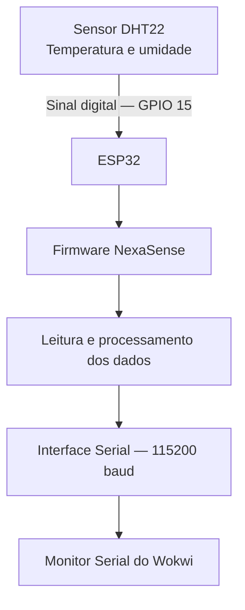

# Diagrama de Arquitetura — NexaSense

## 1. Visão geral

O protótipo utiliza um ESP32 conectado a um sensor DHT22 para realizar a leitura de temperatura e umidade. Os dados são processados pelo microcontrolador e apresentados no Monitor Serial do Wokwi.

## 2. Diagrama

## 3. Componentes

- **DHT22:** realiza a medição de temperatura e umidade.
- **ESP32:** recebe os dados do sensor e executa o firmware.
- **Firmware:** realiza a leitura, valida os valores e envia as informações pela interface serial.
- **Monitor Serial:** apresenta os dados e mensagens de depuração.

## 4. Observação sobre o escopo

A arquitetura representa o protótipo desenvolvido no ambiente Wokwi. Não foram implementadas comunicação Wi-Fi, MQTT, HTTP ou conexão com serviços externos. As interfaces físicas UART, JTAG e a memória Flash não foram submetidas a testes físicos.
